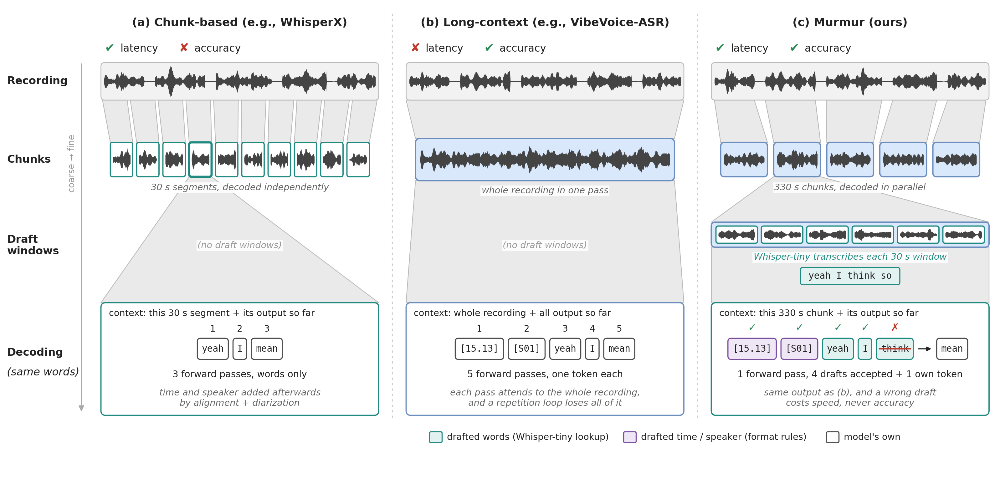

# Murmur: Efficient Long-Context ASR Inference with Hierarchical Chunking

[](https://arxiv.org/abs/2606.01483)

## News

- 2026/11/13: [Blog post](https://syfi.cs.washington.edu/blog/2026-11-13-murmur/) on Murmur is out.
- 2026/11/04: [Preprint v2](https://arxiv.org/abs/2606.01483v2) is out.
- 2026/06/01: [Preprint](https://arxiv.org/abs/2606.01483v1) is released on arXiv.

Murmur is an inference system that serves long-context ASR models, such as **VibeVoice-ASR** and
**MOSS-Transcribe-Diarize**, on long audio. These models transcribe an hour-long recording in a single
pass, which is slow and can fail entirely on a repetition loop.

## Transcribe your first recording

Install Murmur for your hardware, then run the matching command in the environment
you created. Replace `meeting.wav` with the path to your recording.

| Hardware | Setup | First command |
|---|---|---|
| Apple Silicon Mac | [Install MLX](docs/install/mlx.md) | `murmur transcribe meeting.wav --model moss --backend mlx` |
| NVIDIA GPU | [Install vLLM](docs/install/vllm.md) | `murmur transcribe meeting.wav --model moss --backend vllm` |

MOSS prints timestamped speaker turns. Example output for a short recording:

```text
== meeting.wav
[   0.80-   3.20] SPEAKER_00: Should we start with the budget?
[   3.45-   5.10] SPEAKER_01: Yes, I have the numbers here.
```

For Python examples and JSON output, see the [transcription guide](docs/transcription.md).

## How Murmur works

- **Across chunks:** Murmur decodes ~5-minute target chunks in parallel. This intermediate size gives
  the model enough context to match single pass in most cases, and a loop costs at most one chunk.
- **Within each chunk:** hierarchical chunking splits each chunk into 30 s draft windows. A small
  Whisper model transcribes them, and structure-aware drafting adds the timestamps and speaker tags,
  giving drafts for speculative decoding. The long-context model verifies every token, so decoding is
  faster and the output is unchanged.

Overall, Murmur is **2.5x faster** than single pass on average (2.0-2.9x), end to end including
diarization, and lowers tcpWER by 2.0 points on average.



## Demo

Single pass, Murmur and WhisperX transcribing the same 32-minute AMI meeting on one H100, replayed at 8x.

https://github.com/user-attachments/assets/e2897c2a-cc33-4021-8e2d-7dfbac46f8c9

## Results

Murmur against each model's own single pass on four meeting datasets. Each cell is tcpWER / latency
per recording (lower is better), on one H100 with vLLM, with latency including diarization.

| Model | System | AMI-IHM | AMI-SDM | AliMeeting | AISHELL-4 |
|---|---|---|---|---|---|
| VibeVoice-ASR | single pass | 30.1% / 109 s | 39.6% / 100 s | 41.7% / 123 s | **30.3%** / 111 s |
| | **Murmur** | **24.5% / 38 s** | **32.9% / 39 s** | **38.7% / 47 s** | 30.5% / **46 s** |
| MOSS-Transcribe-Diarize | single pass | 17.5% / 54 s | 29.6% / 77 s | **13.6%** / 91 s | **14.1%** / 51 s |
| | **Murmur** | **17.3% / 26 s** | **22.8% / 26 s** | 17.5% / **32 s** | 16.6% / **26 s** |

<sub>Bold: better of single pass and Murmur. WER, cpWER and DER are in the paper. AMI scores use a
corrected reference reader (2-6 points lower than earlier arXiv versions).</sub>

## Supported models

The vLLM backend supports the four models below. The MLX backend supports all four on Apple Silicon.
Draft window defaults in the tables apply to vLLM.

**Diarizing ASR models** write the words, timestamps and speaker labels themselves.

| Model | `Murmur.load(...)` | Draft windows | Max audio | Tested on | vLLM server |
|---|---|---|---|---|---|
| [VibeVoice-ASR](https://huggingface.co/microsoft/VibeVoice-ASR) (8.5B) | `"vibevoice"` | on | 60 min | English, Mandarin | vLLM 0.14 + VibeVoice plugin |
| [MOSS-Transcribe-Diarize](https://huggingface.co/OpenMOSS-Team/MOSS-Transcribe-Diarize) (0.9B) | `"moss"` | off | 90 min | English, Mandarin | vLLM nightly |

**Text-only ASR models** write plain text; Murmur adds word times (from the short-window Whisper
model) and speakers (from pyannote).

| Model | `Murmur.load(...)` | Draft windows | Max audio | Tested on | vLLM server |
|---|---|---|---|---|---|
| [Voxtral Mini](https://huggingface.co/mistralai/Voxtral-Mini-3B-2507) (3B) | `"voxtral"` | on | 30 min | English | vLLM 0.14 |
| [Voxtral Small](https://huggingface.co/mistralai/Voxtral-Small-24B-2507) (24B) | `"voxtral-small"` | on | 30 min | English | vLLM 0.14 |

A single pass over a model's max audio length is split into the fewest pieces that fit.

### Supporting models

| Component | Supported model |
|---|---|
| Draft words and word times (English) | Whisper tiny via `faster-whisper` |
| Draft words and word times (Mandarin) | Whisper small via `faster-whisper` |
| Speaker diarization pipeline | [pyannote/speaker-diarization-3.1](https://huggingface.co/pyannote/speaker-diarization-3.1) |
| Speaker segmentation | [pyannote/segmentation-3.0](https://huggingface.co/pyannote/segmentation-3.0) |
| Speaker embeddings | [pyannote/wespeaker-voxceleb-resnet34-LM](https://huggingface.co/pyannote/wespeaker-voxceleb-resnet34-LM) |

### Experimental diarization models

These two models run together in a standalone Mac prototype. The Murmur CLI and Python API use the pyannote pipeline listed above.

| Component | Prototype model |
|---|---|
| Speaker segmentation | Reverb Diarization V1 (INT8) |
| Speaker embeddings | NeMo TitaNet Small |

## Benchmarks

`benchmarks/run.py` reproduces the paper's results, one model, dataset and system at a time.

```bash
python benchmarks/run.py --model vibevoice --dataset ami_ihm --system murmur --mode latency
```

<details>
<summary>Datasets, systems and scoring</summary>

```bash
bash benchmarks/prepare/download_ami.sh && python benchmarks/prepare/build_ami_sessions.py   # needs lhotse
python benchmarks/prepare/download_alimeeting_refs.py --archives Eval_Ali.tar.gz Test_Ali.tar.gz --raw_dir /tmp/ali   # OpenSLR 119
python benchmarks/prepare/download_aishell4_refs.py --archive test.tar.gz --raw_dir /tmp/aishell4                    # OpenSLR 111
```

`--system`: `single`, `chunked` (greedy), `murmur` (as in the paper; `--draft-windows on|off`
overrides) or `ngram` (vLLM prompt lookup). `--mode latency` reports end-to-end latency per
recording; `--mode throughput` reports decoding time for a whole dataset. Scoring: WER (CER for
Mandarin) with jiwer, cpWER and tcpWER (5 s collar) with MeetEval, DER with pyannote.metrics.
</details>

## Citation

```bibtex
@article{murmur2026lee,
  title={Murmur: Efficient Long-Context ASR Inference with Hierarchical Chunking},
  author={Lee, Wei-Tzu and Kamahori, Keisuke and Kasikci, Baris},
  journal={arXiv preprint arXiv:2606.01483},
  year={2026},
  url={https://arxiv.org/abs/2606.01483}
}
```

## Continuous integration

Pull requests run CPU tests on Python 3.10 and 3.12 and install the built wheel in a clean environment. The release workflow publishes the same wheel that passed the installation check.

The **Hardware inference** workflow runs Voxtral Mini INT4 on Apple Silicon and VibeVoice with speculative decoding on CUDA each night. Select `full` in **Run workflow** to test all 12 MLX checkpoints and all four vLLM models before tagging a release. Publishing a release repeats the enabled suites against the release commit before uploading distributions to PyPI. A weekly CUDA benchmark records tcpWER, failed chunks, and end-to-end latency for VibeVoice on AMI-IHM ES2004a in the workflow summary and artifacts. Select `benchmark` to reproduce it on demand.

Hardware suites activate independently. Provision a dedicated runner for each backend, configure the following environment for the runner service, then set the corresponding GitHub Actions repository variable to `true`.

| Runner label | Runner environment | Repository variable |
| --- | --- | --- |
| `murmur-mlx` | macOS ARM64 with Metal and enough unified memory for Voxtral Small BF16 (about 48 GB for weights plus inference memory). Set `MURMUR_CI_PYTHON` to the absolute Python 3.12 executable with the three MLX runtimes from the Apple Silicon setup and the `test` extra installed. | `MURMUR_MLX_CI` |
| `murmur-cuda` | Linux x64 GPU sized for Voxtral Small and Whisper. Set `MURMUR_CI_PYTHON` to the absolute client Python executable with the `all` and `test` extras. Set `MURMUR_VLLM_VIBEVOICE`, `MURMUR_VLLM_MOSS`, and `MURMUR_VLLM_VOXTRAL` to their model-specific vLLM executables. | `MURMUR_CUDA_CI` |

Set `MURMUR_AMI_ES2004A` on both runners to the readable AMI `ES2004a.Mix-Headset.wav`. On CUDA also set `MURMUR_DATA` to the prepared benchmark dataset root with the ES2004a audio and STM/RTTM references, and configure the runner user’s Hugging Face access for pyannote. Keep the benchmark on the same GPU for comparable timings. Hardware jobs run the checked-out source against these provisioned dependencies. Use a runner group restricted to the trusted hardware workflow or isolated ephemeral runners.
