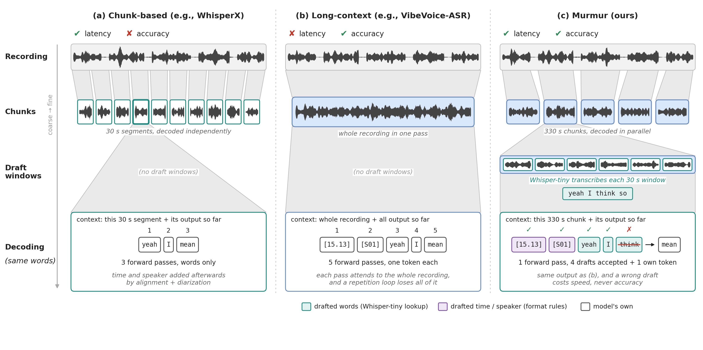
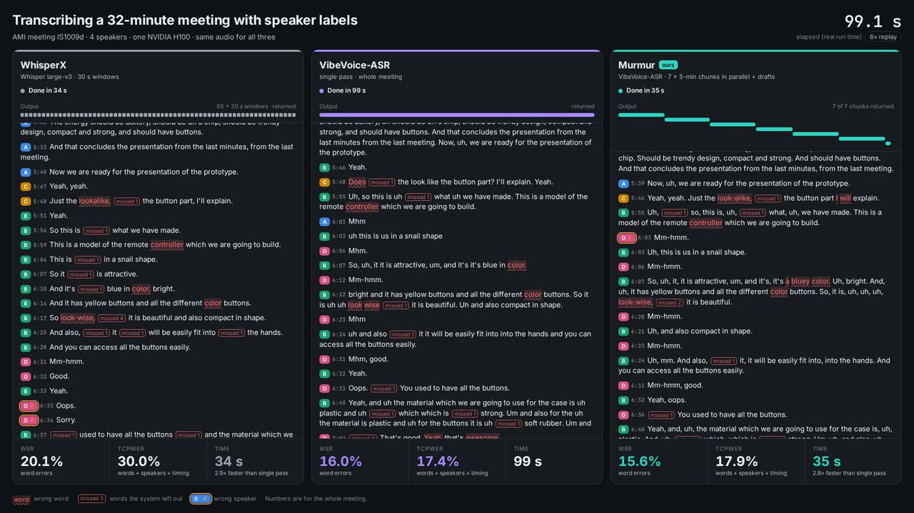

# Murmur: Efficient Long-Context ASR Inference with Hierarchical Chunking

[](https://arxiv.org/abs/2606.01483)

Long-context ASR models such as **VibeVoice-ASR** and **MOSS-Transcribe-Diarize** transcribe an
hour-long meeting in one pass, with speakers and timestamps. That single pass is slow, and one
repetition loop can wipe out the whole transcript. Murmur makes these models faster without
changing what they write:

- **Target chunks (~5 min).** A few minutes of context is enough: 330 s chunks match or beat
  single-pass accuracy, confine a repetition loop to one chunk, and decode in parallel.
- **Draft windows (30 s).** A small short-window ASR (Whisper-tiny/small) transcribes each chunk;
  its words, simple format rules for timestamps and speaker tags, and the model's own output become
  drafts for speculative decoding. The model verifies every token, so the output is its own greedy
  output. Murmur enables draft windows when a decoding step is expensive (VibeVoice-ASR's 7B decoder),
  not for small decoders (MOSS-Transcribe-Diarize's 0.6B).



## Demo

WhisperX, VibeVoice-ASR single pass and Murmur (VibeVoice-ASR) on the same 32-minute AMI meeting
(IS1009d), one H100, replayed at 12x. Each transcript and its scores appear only once that system has
finished. Click the image to play the video.

[](./docs/media/murmur_demo.mp4)

## Results

On average Murmur is 2.5x faster than single pass (2.0-2.9x) and lowers tcpWER by 2.0 points. It
beats WhisperX on tcpWER on every dataset, at about the same latency with VibeVoice-ASR and lower
latency with MOSS-Transcribe-Diarize. One NVIDIA H100, vLLM; latency includes diarization.

**AMI-IHM** (English, headset mics, 16 meetings)

| System | WER (%) | tcpWER (%) | Latency (s) |
|---|--:|--:|--:|
| WhisperX | 24.6 | 31.9 | 36.3 |
| VibeVoice-ASR, single pass | 27.8 | 30.1 | 108.9 |
| VibeVoice-ASR + **Murmur** | **20.2** | **24.5** | **38.0** |
| MOSS-Transcribe-Diarize, single pass | 19.4 | 17.5 | 54.2 |
| MOSS-Transcribe-Diarize + **Murmur** | **17.5** | **17.3** | **26.4** |

**AMI-SDM** (English, one distant mic, 16 meetings)

| System | WER (%) | tcpWER (%) | Latency (s) |
|---|--:|--:|--:|
| WhisperX | 30.2 | 39.6 | 35.0 |
| VibeVoice-ASR, single pass | 27.9 | 39.6 | 99.5 |
| VibeVoice-ASR + **Murmur** | **26.8** | **32.9** | **38.5** |
| MOSS-Transcribe-Diarize, single pass | 24.7 | 29.6 | 77.1 |
| MOSS-Transcribe-Diarize + **Murmur** | **20.5** | **22.8** | **26.4** |

**AliMeeting** (Mandarin, 28 meetings)

| System | CER (%) | tcpWER (%) | Latency (s) |
|---|--:|--:|--:|
| WhisperX | 33.3 | 68.6 | 36.4 |
| VibeVoice-ASR, single pass | 40.3 | 41.7 | 122.5 |
| VibeVoice-ASR + **Murmur** | **34.1** | **38.7** | **47.1** |
| MOSS-Transcribe-Diarize, single pass | **16.8** | **13.6** | 90.8 |
| MOSS-Transcribe-Diarize + **Murmur** | 17.4 | 17.5 | **31.6** |

**AISHELL-4** (Mandarin, 20 meetings)

| System | CER (%) | tcpWER (%) | Latency (s) |
|---|--:|--:|--:|
| WhisperX | 26.2 | 40.5 | 42.4 |
| VibeVoice-ASR, single pass | 25.0 | **30.3** | 110.9 |
| VibeVoice-ASR + **Murmur** | **22.6** | 30.5 | **45.6** |
| MOSS-Transcribe-Diarize, single pass | **14.0** | **14.1** | 50.8 |
| MOSS-Transcribe-Diarize + **Murmur** | 14.3 | 16.6 | **26.1** |

Lower is better. Bold marks the better of single pass and Murmur for each model. MOSS-Transcribe-Diarize's
single pass stays ahead on Mandarin speaker attribution, since it diarizes the whole recording jointly.

<sub>WhisperX: 30 s windows with Whisper large-v3 and pyannote. Single pass: the whole recording at
once. Murmur: target chunks + draft windows for VibeVoice-ASR, target chunks for MOSS-Transcribe-Diarize.
AMI scores use a corrected reference reader; the first arXiv versions report AMI error rates 2-6 points
higher for every system.</sub>

## Install

The client and each model's vLLM server live in separate environments, because the two models need
different vLLM builds.

**Client** (the `murmur` package):
```bash
conda create -n murmur python=3.10 -y && conda activate murmur
git clone https://github.com/uw-syfi/Murmur.git && cd Murmur
pip install -e ".[all]"            # diarization (pyannote), draft windows (faster-whisper), scoring
huggingface-cli login              # pyannote/speaker-diarization-3.1 is gated: accept its terms first
```

**VibeVoice-ASR server** (vLLM 0.14 + the VibeVoice vLLM plugin):
```bash
conda create -n vibevoice-vllm python=3.10 -y && conda activate vibevoice-vllm
pip install vllm==0.14.0
git clone https://github.com/microsoft/VibeVoice.git && pip install -e VibeVoice
pip install -e "path/to/Murmur[server]"   # the drafter plugin
```

**MOSS-Transcribe-Diarize server** (a vLLM nightly with the model's code):
```bash
conda create -n moss-vllm python=3.10 -y && conda activate moss-vllm
pip install -U vllm --pre --extra-index-url https://wheels.vllm.ai/nightly   # tested: 0.23.1rc1.dev949
pip install -e "path/to/Murmur[server]"
```

Tell the client where each server's `vllm` is, so it can start servers itself:
```bash
export MURMUR_VLLM_VIBEVOICE=$CONDA_PREFIX/../vibevoice-vllm/bin/vllm
export MURMUR_VLLM_MOSS=$CONDA_PREFIX/../moss-vllm/bin/vllm
```

## Quick start

```python
from murmur import Murmur

with Murmur.load("vibevoice") as m:          # starts a vLLM server on a free port
    t = m.transcribe("meeting.wav")
    print(t)                                  # [  12.40-  15.10] SPEAKER_01: ...
    for s in t.segments:
        print(s.speaker, s.start, s.end, s.text)

m = Murmur.load("moss", language="zh")       # Mandarin; MOSS uses target chunks only by default
```

Or start the server yourself (e.g. on another GPU) and point the client at it:
```bash
# in the vibevoice-vllm environment
CUDA_VISIBLE_DEVICES=0 murmur serve vibevoice --port 8000 --draft-dir /tmp/murmur_drafts
# in the murmur environment
murmur transcribe meeting.wav --model vibevoice --url http://localhost:8000 --draft-dir /tmp/murmur_drafts
```
The draft directory is how the client hands each chunk's draft transcript to the server, so client
and server must run on the same machine (or share that directory).

Options of `Murmur.load`: `chunk_s` (target chunk length, default 330), `batch_size` (chunks decoded
concurrently, default 8), `draft_windows` (default: on for VibeVoice-ASR, off for MOSS), `language`
(`"en"` or `"zh"`, picks the draft model), `diarize` (pyannote for chunk boundaries and speaker
linking; without it, chunks are fixed windows and speakers are not linked across chunks), `gpu`.
`transcribe(..., single_pass=True)` runs the single-pass baseline.

## Benchmarks

Prepare the datasets (written to `benchmarks/meeting_datasets/`, or `$MURMUR_DATA`):
```bash
bash benchmarks/prepare/download_ami.sh && python benchmarks/prepare/build_ami_sessions.py   # needs lhotse
python benchmarks/prepare/download_alimeeting_refs.py --archives Eval_Ali.tar.gz Test_Ali.tar.gz --raw_dir /tmp/ali   # OpenSLR 119
python benchmarks/prepare/download_aishell4_refs.py --archive test.tar.gz --raw_dir /tmp/aishell4                    # OpenSLR 111
```

Run one configuration:
```bash
python benchmarks/run.py --model vibevoice --dataset ami_ihm --system murmur --mode latency
```
`--system` is `single`, `chunked` (greedy), `murmur` (draft windows for VibeVoice-ASR, target chunks
only for MOSS-Transcribe-Diarize, as in the paper; `--draft-windows on|off` overrides) or `ngram`
(vLLM's prompt-lookup baseline);
`--mode latency` processes recordings one at a time and reports end-to-end latency per recording,
`--mode throughput` decodes all chunks of a dataset through one pool and reports decoding time.

Scoring follows the paper: WER (CER for Mandarin) with jiwer, cpWER and tcpWER (5 s collar) with
MeetEval, DER with pyannote.metrics (0.25 s collar, overlap scored), averaged over recordings.

## Citation

```bibtex
@article{murmur2026lee,
  title={Murmur: Efficient Long-Context ASR Inference with Hierarchical Chunking},
  author={Lee, Wei-Tzu and Kamahori, Keisuke and Kasikci, Baris},
  journal={arXiv preprint arXiv:2606.01483},
  year={2026},
  url={https://arxiv.org/abs/2606.01483}
}
```
